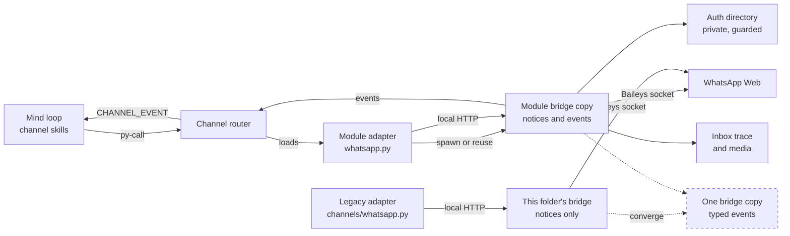
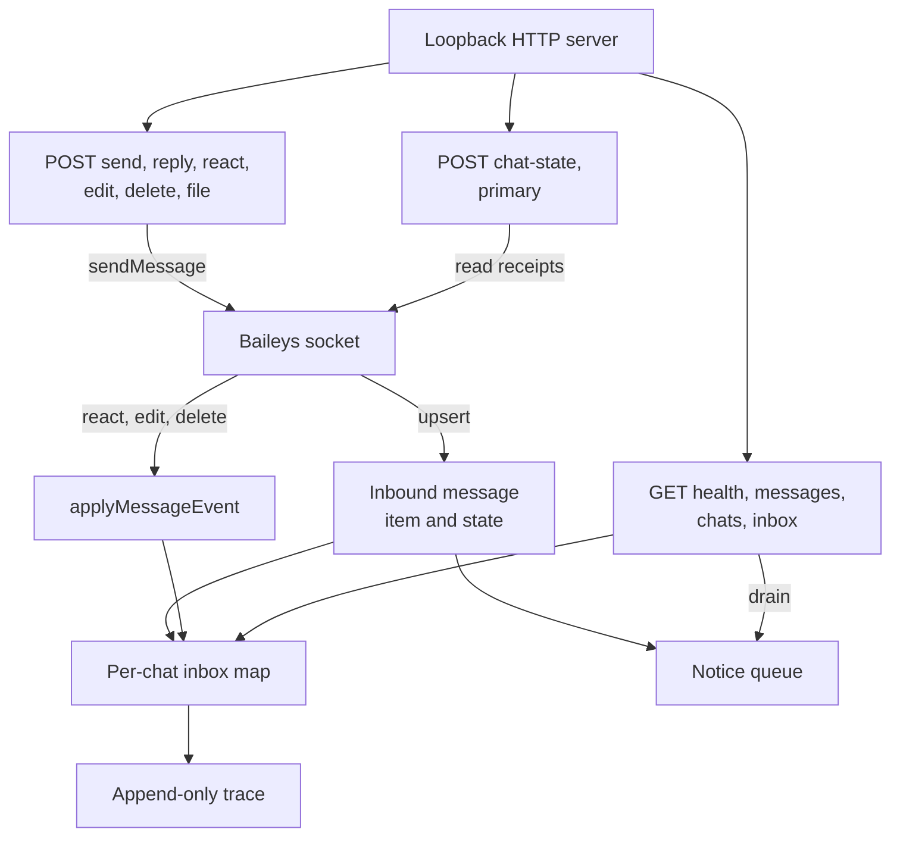

> **Closed Source for Product Consideration.** Shared privately with the SingularityNET team. Do not publish, redistribute or relicense as open source.

# WhatsApp bridge schematics

> Status key: solid line = built; dashed line = intended, not finished. Code refs are to omegahive @ 34b0fb3 unless named.

**What this shows.** The WhatsApp bridge is an optional Node.js process that links a mind's WhatsApp channel to WhatsApp Web through the unofficial Baileys client. Python adapters talk to it over local HTTP only. This folder is the copy under the legacy `channels/` tree; the module copy under `modules/channel_whatsapp/src/whatsapp_bridge/` is the one the current channel module loads. This page shows both paths, the bridge's surface, and where the channel is meant to go.

**Who should read it.** The owner of the WhatsApp channel (`modules/channel_whatsapp/` and both bridge copies). Reviewers of channel modules, outbound messaging and licensing. The open side of channels is drawn in `omegahive-schematics/03-minds/04-channels-and-external-members.md`.

## Diagrams

### 1. How it connects

### 2. Inside the bridge

## How it works

**It is a separate process on the loopback.** The bridge listens only on the loopback address, on a configurable port (`channels/whatsapp_bridge/bridge.mjs:935-937`). It narrows its umask and creates its auth and inbox directories at 0700 (`bridge.mjs:17`, `:43-47`). Settings come from `OMEGACLAW_WA_*` environment variables: auth directory, port, target and primary chat, outbound prefix, listen list, pairing number and whether to include own messages (`bridge.mjs:21-41`).

**It refuses the wrong account.** Before connecting, an identity guard reads the saved credentials and exits if the linked account's name is forbidden or not the expected one (`bridge.mjs:49-74`).

**Inbound messages become items, notices and a trace.** The `messages.upsert` handler skips its own sends, builds an item with chat, sender, kind, text, timestamp and read state, saves media, and queues a notice (`bridge.mjs:625-678`). Reactions, edits and deletions update the stored item (`bridge.mjs:679-757`). Every change is appended to a JSONL trace that is replayed at start (`bridge.mjs:136-142`, `:333-363`). Pairing writes a QR code image and text for the operator (`bridge.mjs:601-623`).

**The HTTP surface is small and local.** Reads: health, drained notices (or unread reminders when the queue is empty), chats, inbox summary and one chat's recent messages. Writes: chat read state, primary chat, send, send with mention, send file, reply to a message, react, edit and delete (`bridge.mjs:776-933`). Sending to a stale alias of the primary chat is refused (`bridge.mjs:111-117`, `:835-836`).

**Python starts or reuses it.** `start_whatsapp` reuses a live bridge on the port, otherwise spawns `node bridge.mjs` in the adapter's sibling `whatsapp_bridge` folder with the settings in its environment (`channels/whatsapp.py:17`, `:131-169`). The same code exists in the module adapter (`modules/channel_whatsapp/src/whatsapp.py:131`).

**The current module path uses the module copy.** The channel module imports `modules/channel_whatsapp/src/whatsapp.py` (`modules/channel_whatsapp/entry.metta:77`), and the router loads that file as its WhatsApp adapter (`modules/channel_router/src/router.py:8-13`, `:28-49`). Its bridge copy adds a structured `event` to each notice and returns `events` from `/messages` (`modules/channel_whatsapp/src/whatsapp_bridge/bridge.mjs:407-420`, `:843-846`). The router turns those into `CHANNEL_EVENT` views, and falls back to parsing notice strings when there are none (`router.py:284-296`). This folder's copy returns notices only (`channels/whatsapp_bridge/bridge.mjs:782-791`), so the legacy adapter's `getLastEvents` is always empty with it (`channels/whatsapp.py:183-195`). The `channels/` tree is marked legacy (`channels/LEGACY.md`).

**The channel is optional and off by default.** The module declares `optional = true`, `default_enabled = false`, needs Node 20 or later, and lists its skills and trace events (`modules/channel_whatsapp/module.toml:1-73`).

**Licensing.** `npm install` fetches `libsignal` (GPL-3.0) through Baileys, so distributing this folder with its installed dependencies distributes GPL-3.0 code; the folder is closed for product consideration until legal decides or the dependency is replaced (`channels/whatsapp_bridge/GPL-NOTICE.md`). Baileys is unofficial and may conflict with WhatsApp's terms (same file).

## Intended shape and upgrade path

- **Typed channel events everywhere.** New channel work should emit structured `ChannelEvent` payloads (event, channel, route, conversation id, message id, sender, text, reply affordance) rather than strings (`docs/reference-channels.md:18-66`, `docs/omegaclaw-core.md:53`). Both documents are marked legacy reference, but the router implements the contract (`router.py:133`). The module copy does this; this folder's copy does not. Converging on one copy is the dashed box in diagram 1. No document schedules it.
- **A licence decision** or a replacement for the GPL-3.0 dependency before any external distribution (`GPL-NOTICE.md`, "What this means").

## Seams and contracts

| Seam | Where | Shape |
|---|---|---|
| HTTP reads | `bridge.mjs:779-807` | `GET /health`, `/messages`, `/chats`, `/inbox`, `/chat-messages?jid&limit` |
| HTTP writes | `bridge.mjs:809-932` | `POST /chat-state`, `/primary`, `/send`, `/send-mention`, `/send-file`, `/reply-to-message`, `/react`, `/edit`, `/delete` |
| `/messages` answer | this copy `bridge.mjs:791`; module copy `:846` | `{ok, messages}`; module copy adds `events` |
| Settings | `bridge.mjs:21-41`, `:49-74` | `OMEGACLAW_WA_AUTH_DIR`, `_PORT`, `_TARGET_JID`, `_PRIMARY_JID`, `_PRIMARY_ALIASES`, `_PREFIX`, `_PAIR_PHONE`, `_LISTEN_JIDS`, `_INCLUDE_OWN`, `_EXPECT_SELF_NAME`, `_FORBID_SELF_NAMES` |
| Adapter calls | `channels/whatsapp.py:131-501` | start, stop, getLastMessage, getLastEvents, send and read functions |
| Module card | `modules/channel_whatsapp/module.toml` | id, kind channel, optional, provides, requires, env, trace |

## For owners: how to plug in

1. **Install and run** in the folder the adapter uses: `npm install`, then `node bridge.mjs` (Node 22.12 or later per `README.md`; the module card says 20 or later).
2. **Enable the channel module** for a mind; it is off by default. Set the `WA_*` values at runtime, never in source (`module.toml`, `[env]`).
3. **Change the bridge in one place.** Until the copies converge, make the same change in both copies, and keep `tests/test_device_smoke.py` passing, which reads this folder's files.

## For reviewers: what to check

- **Loopback only.** The `listen` call binds the loopback address (`bridge.mjs:935`).
- **Identity guard stays on.** `bridge.mjs:49-74`; `tests/test_whatsapp_jid_guard.py`.
- **Deployment-neutral defaults.** `tests/test_device_smoke.py:62-66`.
- **Copies drift.** Diff the two `bridge.mjs` files on every change; at this commit they differ by the typed-event additions.
- **Risk.** Outbound sends leave the system. Any skill that sends must stay behind the mind's own effect policy; this bridge does no authorization of its own beyond the loopback bind.

## References

- `channels/whatsapp_bridge/bridge.mjs:17`, `:21`, `:49`, `:576`, `:625`, `:776`, `:935`
- `channels/whatsapp.py:17`, `:131`, `:183`
- `modules/channel_whatsapp/src/whatsapp_bridge/bridge.mjs:407`, `:843`
- `modules/channel_whatsapp/entry.metta:77`, `modules/channel_whatsapp/module.toml`
- `modules/channel_router/src/router.py:8`, `:28`, `:133`, `:272`
- `channels/whatsapp_bridge/GPL-NOTICE.md`, `channels/LEGACY.md`, `docs/reference-channels.md:18`
