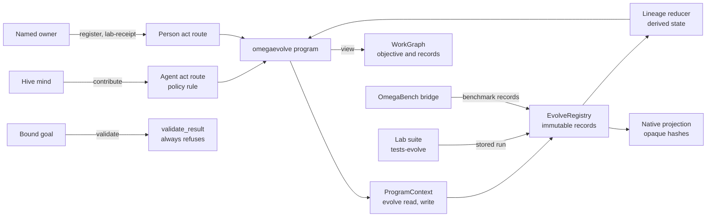
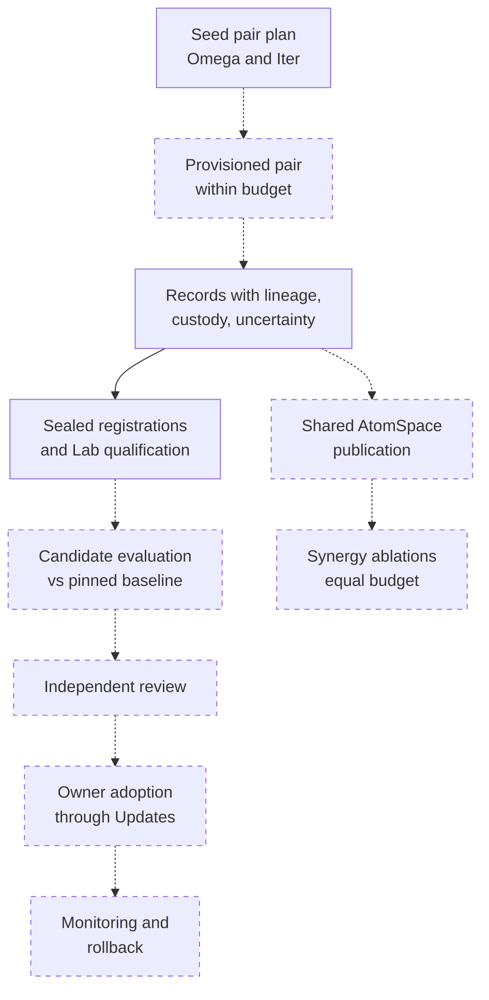

> **Closed Source for Product Consideration.** Shared privately with the SingularityNET team. Do not publish, redistribute or relicense as open source.

# OmegaEvolve schematics

> Status key: solid line = built; dashed line = intended, not finished. Code refs are to omegahive @ 34b0fb3 unless named.

**What this shows.** OmegaEvolve is a built-in hive program for shared research toward its fixed objective: minds and people add immutable, attributed research records, and a named owner registers sealed offline experiments. This page shows what the program is, how it connects to the hive's Evolve registry and the program-action route, and where it is designed to go.

**Who should read it.** The owner of `hive/plugins/omegaevolve/` and of the host Evolve modules (`hive/core/evolve*.py`). Reviewers of contribution authority, lineage and completion.

## Diagrams

### 1. What it is and how it connects

### 2. Where it is going

## How it works

**The program is a thin view over host records.** `describe` declares kinds (objective, seed, contribution, experiment, qualification, benchmark, benchmark-assessment), relations (advances, evolves toward, depends on, revises, references) and six actions; only `contribute` is open to minds (`hive/plugins/omegaevolve/program.py:6-25`). `view` reads the host snapshot, adds the fixed objective and the two planned seed subjects, and derives links from each record's `depends_on` and `predecessor` (`program.py:28-65`). The revision is a digest of the snapshot and seed plan (`program.py:59`).

**The registry lives in the host and belongs to this program.** `ProgramContext` exposes `evolve_*` calls only when the program id is `omegaevolve` and the `evolve:read` or `evolve:write` capability is declared (`hive/core/programs.py:193-229`, `hive/plugins/omegaevolve/plugin.json`). `EvolveRegistry` stores immutable, swarm-scoped rows with author and digest (`hive/core/evolve.py:1-15`, `:58`).

**Contributions carry no authority.** A contribution needs a trusted host actor, refuses any field outside title, claim, method, evidence, uncertainty, affected revision, predecessor, relation and depends-on, and needs an explicit uncertainty method and status and at least one evidence locator with source, locator and origin; locators are stored with custody unresolved (`hive/core/evolve.py:71-90`). Minds reach it only through the agent act route under an explicit policy rule (`hive/core/program_actions.py:1-10`, `:151`).

**Experiments are sealed by a named owner.** `register` and `lab-receipt` need a host-authenticated named person with owner or admin role; the local operator and minds never qualify (`hive/core/evolve.py:23-28`, `:129`, `:137`). A Lab receipt reads the stored run of the `tests-evolve` suite and keeps its digest (`hive/bench/catalog.py:12`). It confirms protocol qualification only (`hive/plugins/omegaevolve/README.md`, paragraph 4).

**Lineage is derived, not stored as state.** A source-authored correction or retraction revises its source; others can only reference it; changed sources mark dependent claims for review, and restart does not reset a retraction (`hive/core/evolve_state.py:2`, `README.md`, paragraph 5).

**The native projection is data only.** `evolve_projection.project` turns records into typed MeTTa data keyed by opaque hashes; submitted text never becomes executable (`hive/core/evolve_projection.py:5-12`).

**Completion is refused on purpose.** `validate_result` always returns an error until candidate evaluation and independent review are wired, so a bound goal cannot finish through this program (`program.py:94-95`; `hive/core/programs.py:1100-1107`).

## Intended shape and upgrade path

- **Evaluation, review, adoption, monitoring, rollback.** Native shared AtomSpace publication, Omega-body integration, the budget, reviewer routing, Updates adoption, monitoring and rollback remain platform work (`README.md`, paragraph 7). The objective cannot self-amend and the hive owner adopts changes (`hive/core/evolve_seed.py:9-35`).
- **The seed pair.** `seed_plan` specifies two private subjects (an Omega and an Iter) with a swarm day budget and `adoption_authorized: False`; it never creates, starts or grants a mind (`hive/core/evolve_seed.py:9-35`, `docs/omegaevolve/SEED_PAIR.md`).
- **Research meaning, synergy tests.** Retain the workflow as the research spine, add typed native relations, and test cognitive synergy with equal-budget ablations (`docs/omegaevolve/HYPERON_THEORY_REVIEW.md:63-75`).

## Seams and contracts

| Seam | Where | Shape |
|---|---|---|
| Manifest | `hive/plugins/omegaevolve/plugin.json` | id `omegaevolve`, contract 0.1, capabilities `evolve:read`, `evolve:write` |
| Context calls | `hive/core/programs.py:200-229` | evolve_records, evolve_snapshot, evolve_contribute, evolve_register, evolve_benchmark_register, evolve_benchmark_assess, evolve_benchmark_receipt, evolve_lab_receipt |
| Contribution | `hive/core/evolve.py:71-90` | title, claim, method, evidence [source, locator, origin], uncertainty {method, status}, affected_revision, optional predecessor, relation, depends_on |
| Objective | `hive/core/evolve_preflight.py:6` | fixed string |
| Completion hook | `program.py:94` | always `{"errors": [...]}` |

## For owners: how to plug in

1. **Extend the record model in the host**, not in the program: `hive/core/evolve.py` and `evolve_state.py`. Keep authority fields out of contributions.
2. **Add an action** in `describe` and route it in `act` (`program.py:68-91`); mark `agents: true` only for actions minds may call.
3. **Run qualification**: the pytest list and `python -m hive.bench run tests-evolve` in `README.md`.

## For reviewers: what to check

- **No authority or code in contributions.** `hive/tests/test_evolve.py`.
- **Lineage and retraction.** `hive/tests/test_evolve_lineage.py`.
- **Native projection is data.** `hive/tests/test_evolve_native.py`.
- **API and program actions.** `hive/tests/test_evolve_api.py`, `hive/tests/test_program_actions.py`.
- **Seed plan grants nothing.** `hive/tests/test_evolve_seed.py`.
- **Risk.** Protocol qualification is not measured improvement. Any change that lets `validate_result` pass needs candidate evaluation and independent review first.

## References

- `hive/plugins/omegaevolve/program.py:6`, `:28`, `:68`, `:94`
- `hive/core/programs.py:193`, `:1100`; `hive/core/program_actions.py:1`
- `hive/core/evolve.py:21`, `:58`, `:71`, `:129`, `:137`; `hive/core/evolve_state.py:2`; `hive/core/evolve_projection.py:5`; `hive/core/evolve_seed.py:9`
- `docs/omegaevolve/HYPERON_THEORY_REVIEW.md:63`, `docs/omegaevolve/SEED_PAIR.md`
