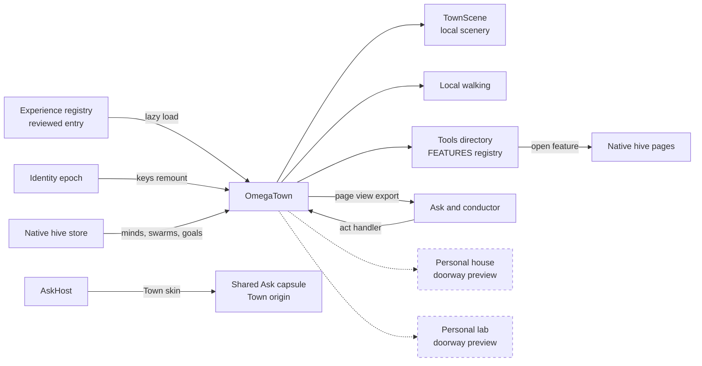
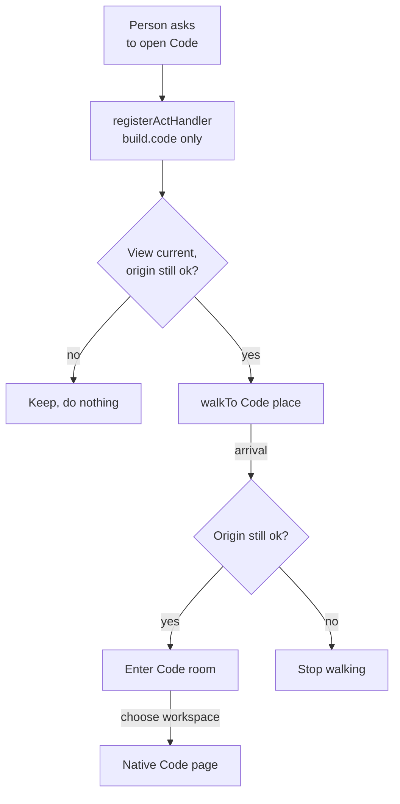

> **Closed Source for Product Consideration.** Shared privately with the SingularityNET team. Do not publish, redistribute or relicense as open source.

# OmegaTown schematics

> Status key: solid line = built; dashed line = intended, not finished. Code refs are to omegahive @ 34b0fb3 unless named; paths are relative to `hive/ui/src/`.

**What this shows.** OmegaTown is a whole alternative front end (an "experience") over the same hive: a walkable town with robot residents, teams, places and a tools directory. Walking is local presentation only; every real action opens the ordinary hive page. This page shows how Town plugs into the experience registry, the hive store and Ask, and which places are previews of later work.

**Who should read it.** The owner of `experiences/omegatown/` and of `features/ask/townSkin.tsx` and `townAsk.css`. Reviewers of experiences, Ask origin binding and private-app exclusion. The host side is drawn in `omegahive-schematics/02-ask-and-ui/02-ui-experiences-and-looks.md`.

## Diagrams

### 1. What it is and how it connects

### 2. An Ask that walks: "open Code"

## How it works

**Town is one entry in the experience registry.** The entry names Town, its swatch and a lazy `import('./omegatown')`, and is marked reviewed so release builds include it (`experiences/registry.ts:80-90`). Experiences own layout, navigation and motion over the same hive; classic pages still open over any experience (`experiences/registry.ts:4-8`).

**It reads the native store and writes nothing of its own.** Town reads minds, swarms, goals, approvals and programs from `useHive` and asks the store's own loaders to refresh them; there is no direct client, fetch, duplicate cache or owner-data write (`experiences/omegatown/index.tsx:66-79`). Residents are placed deterministically from their ids; a visual seed is never a hive reference or presence (`experiences/omegatown/world.ts:16-31`).

**Identity changes reset it.** The component is keyed by the identity epoch, and `current(ctx)` requires the same epoch, a ready client and an authorized connection before any state change (`experiences/omegatown/binding.ts:4-9`, `index.tsx:22-27`). The only remembered state is one volatile pose, cleared on identity change (`binding.ts:12-22`).

**Walking is local.** Arrow and WASD keys or a path move the visitor; walking stops when typing, when a dialog covers the town, or when the window is hidden (`experiences/omegatown/movement.ts:6-30`). Places sit at fixed points, and `nearest` decides which one the visitor stands by (`world.ts:7-14`, `:35-38`).

**Every real action is a native page.** The tools directory lists the same feature registry as other experiences, filtered by what the person may use (`index.tsx:89-95`, `experiences/omegatown/nav.ts:1-7`). Choosing a feature opens it through `openFeature`; a mind opens its own chat; the Code room opens the real Code workspace picker (`index.tsx:122-131`, `:146-147`, `:206`).

**Ask sees what Town shows.** Town exports a page view (refs to shown minds, swarms and key features, regions and a summary) through `useAskView`, with a liveness check so a stale view is never acted on (`index.tsx:100-117`). Its act handler accepts only `build.code`, rechecks the origin after the submitting event, walks to the Code place and enters on arrival (`index.tsx:155-176`). Ask in Town is the person's own shared capsule, skinned and bound to Town's displayed origin (`features/ask/townSkin.tsx:1-28`, `features/ask/AskHost.tsx:56-58`, `:66`).

**Private apps never appear.** A test forbids any Town place, source, style or skin file from naming a private app; such apps are reached only through the ordinary Apps list (`experiences/omegatown/privateApps.test.ts:1-27`).

## Intended shape and upgrade path

- **Personal house and personal lab** are doorways only; their copy says they are not connected yet and preview a future place (`world.ts:11-12`). No document in this repository specifies what they connect to; treat both as open design.
- **Experiences stay host code.** New experiences register through the same registry without editing others (`docs/MODULARITY.md:35`).

## Seams and contracts

| Seam | Where | Shape |
|---|---|---|
| Registry entry | `experiences/registry.ts:80-90` | id, name, tagline, blurb, swatch, load, reviewed |
| Chrome tokens | `experiences/omegatown/chrome.ts:4-10` | `ExperienceChrome` surface, ink, accent, font, radius, material |
| Page view | `index.tsx:100-110` | title, refs (mind, swarm, feature), acts, regions, summary |
| Act handler | `index.tsx:155` | `registerActHandler('omegatown', act)` returns true, false or 'keep' |
| Ask skin | `features/ask/AskHost.tsx:66` | `omegatown: 'town-capsule'` |
| Origin check | `binding.ts:5-9` | `current(ctx)` |

## For owners: how to plug in

1. **Add a place** to `PLACES` in `world.ts` with a point and plain copy; keep door clearances (`world.ts:21`). Never name a private app.
2. **Wire its room** to an existing native feature with `openFeature` or `navigate`; do not add a direct client call.
3. **Run the UI tests** that cover Town: `experiences/omegatown/privateApps.test.ts`, `experiences/dualP2.test.ts`, `experiences/reviewed.test.ts`.

## For reviewers: what to check

- **No private app anywhere in Town.** `experiences/omegatown/privateApps.test.ts`.
- **Repeated clicks renew the view; a new identity gets a fresh Town.** `experiences/dualP2.test.ts:151`, `:221`.
- **Release gating.** `experiences/reviewed.test.ts:11`.
- **Risk.** Scene art can drift into implying presence or activity. Comments require art to stay scenery, never a native activity or online person (`experiences/omegatown/TownScene.tsx:6`).

## References

- `experiences/registry.ts:4`, `:80`
- `experiences/omegatown/index.tsx:22`, `:66`, `:100`, `:117`, `:155`, `:206`
- `experiences/omegatown/binding.ts:4`, `:12`; `movement.ts:10`; `world.ts:7`, `:23`, `:35`
- `features/ask/townSkin.tsx:1`, `features/ask/AskHost.tsx:56`
- `experiences/omegatown/privateApps.test.ts:1`
